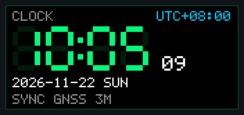

# PSOC&trade; Edge MCU: Graphics DSI ULPM on data lane

This code example demonstrates entry and exit in MIPI Display Serial Interface Ultra-Low-Power Mode (DSI ULPM) on the data lane only. In this mode, the DSI PHY state machine is entering a low-power state on the data lane and allows it to save some power when the LCD does not need to display. When the display is needed again, the DSI ULPM on the data lane is exited and the display should operate as before.
This code example uses a 4.3-inch Capacitive Touch IPS Display for Raspberry Pi, DSI Interface, 800x480 pixel from Waveshare connected via the MIPI DSI interface.

This code example has a three project structure: CM33 secure, CM33 non-secure, and CM55 projects. All three projects are programmed to the external QSPI flash and executed in Execute in Place (XIP) mode. Extended boot launches the CM33 secure project from a fixed location in the external flash, which then configures the protection settings and launches the CM33 non-secure application. Additionally, CM33 non-secure application enables CM55 CPU and launches the CM55 application.

[View this README on GitHub.](https://github.com/Infineon/mtb-example-psoc-edge-gfx-dsi-ulpm-data-lane)

[Provide feedback on this code example.](https://yourvoice.infineon.com/jfe/form/SV_1NTns53sK2yiljn?Q_EED=eyJVbmlxdWUgRG9jIElkIjoiQ0UyMzk1NDAiLCJTcGVjIE51bWJlciI6IjAwMi0zOTU0MCIsIkRvYyBUaXRsZSI6IlBTT0MmdHJhZGU7IEVkZ2UgTUNVOiBHcmFwaGljcyBEU0kgVUxQTSBvbiBkYXRhIGxhbmUiLCJyaWQiOiJhZHZhaXRqaXRlbmRyYS5uZXJsaWthckBpbmZpbmVvbi5jb20iLCJEb2MgdmVyc2lvbiI6IjIuMS4xIiwiRG9jIExhbmd1YWdlIjoiRW5nbGlzaCIsIkRvYyBEaXZpc2lvbiI6Ik1DRCIsIkRvYyBCVSI6IklDVyIsIkRvYyBGYW1pbHkiOiJQU09DIn0=)

See the [Design and implementation](docs/design_and_implementation.md) for the functional description of this code example.

## Requirements

- [ModusToolbox&trade;](https://www.infineon.com/modustoolbox) v3.7 or later (tested with v3.9)
- Board support package (BSP) minimum required version: 1.0.0
- Programming language: C
- Associated parts: All [PSOC&trade; Edge MCU](https://www.infineon.com/products/microcontroller/32-bit-psoc-arm-cortex/32-bit-psoc-edge-arm) parts

## Supported toolchains (make variable 'TOOLCHAIN')

- GNU Arm&reg; Embedded Compiler v14.2.1 (`GCC_ARM`) – Default value of `TOOLCHAIN`
- Arm&reg; Compiler v6.22 (`ARM`)
- IAR C/C++ Compiler v9.70.4 (`IAR`)
- Arm&reg; Toolchain for Embedded v22.1 (`LLVM_ARM`)

## Supported kits (make variable 'TARGET')

- [PSOC&trade; Edge E84 Evaluation Kit](https://www.infineon.com/KIT_PSE84_EVAL) (`KIT_PSE84_EVAL_EPC2`) – Default value of `TARGET`
- [PSOC&trade; Edge E84 Evaluation Kit](https://www.infineon.com/KIT_PSE84_EVAL) (`KIT_PSE84_EVAL_EPC4`)

## Hardware setup

This example uses the board's default configuration. See the kit user guide to ensure that the board is configured correctly.

Ensure the following jumper and pin configuration on board.
- BOOT SW must be in the HIGH/ON position
- J20 and J21 must be in the tristate/not connected (NC) position

### Supported display and electrical connection with KIT_PSE84_EVAL 

- **Waveshare 4.3 inch Raspberry Pi DSI 800*480 display:**  
  Connect the FPC 15-pin cable between the display connector and the PSOC&trade; Edge E84's RPi MIPI DSI connector as outlined in the table below and shown in Figure 1.

  Display's Connector | PSOC&trade; Edge E84 Evaluation Kit's connector
  ------------------- | ----------------------------------------------------
  DSI connector       | J39

  **Figure 1. Display connection with PSOC&trade; Edge E84 evaluation kit**

  

## Software setup

See the [ModusToolbox&trade; tools package installation guide](https://www.infineon.com/ModusToolboxInstallguide) for information about installing and configuring the tools package.

Install a terminal emulator if you do not have one. Instructions in this document use [Tera Term](https://teratermproject.github.io/index-en.html).

This example requires no additional software or tools.

## Operation

See [Using the code example](docs/using_the_code_example.md) for instructions on creating a project, opening it in various supported IDEs, and performing tasks, such as building, programming, and debugging the application within the respective IDEs.

1. Ensure that the 4.3-inch Raspberry Pi DSI LCD is connected to the board

2. Connect the board to your PC using the provided USB cable through the KitProg3 USB connector

3. Open a terminal program and select the KitProg3 COM port. Set the serial port parameters to 8N1 and 115200 baud

4. After programming, the application starts automatically and displays an Infineon logo on the LCD. Confirm that "PSOC Edge MCU: Graphics DSI ULPM On Data Lane" is displayed on the UART terminal followed by the instruction(s) to exercise DSI ULPM mode. As per the instruction(s) displayed on the terminal, press user button 1 (**USER BTN1**) on the kit

   **Figure 2. Infineon logo displayed on LCD**

   

   **Figure 3. Terminal output on program startup**

   

5. On **USER BTN1** press, the LCD turns OFF and the DSI PHY data lane enters in ULPM mode. Confirm the message for DSI ULPM entry on the terminal. The USER LED1 will also turn ON to indicate the same state

   **Figure 4. DSI ULPM entry**

   

6. After being in OFF mode for 6 seconds, the ULPM on data lane exits automatically and the LCD turns back ON, displaying the same image as before with a message indicating exit from ULPM was successful on the UART terminal. Also the USER LED1 will now turn OFF to indicate the DSI PHY data lane in run mode.

   **Figure 5. DSI ULPM exit**

   

## RTC clock (WCO 32.768 kHz) on the HUD (goggle prototype)

The CM55 application shows a clock panel on the right side of the LCD (x 448, y 196, 336 x 150 px). The PSOC Edge RTC runs from the 32.768 kHz watch crystal (WCO, P18.0 `WCO_OUT` / P18.1 `WCO_IN`) through the backup domain clock (`CLK_BAK = WCO` in the BSP), so it keeps counting in Deep Sleep, Hibernate and across a warm reset.

Line | Content
---- | -------
`CLOCK  UTC+08:00` | Time zone (default `RTC_DEFAULT_TZ_MIN` = +8:00, Taiwan)
`10:05 09` | Local time, 7-segment HH:MM and seconds (redrawn when the second changes)
`2026-11-22 SUN` | Local date and day of week
`SYNC GNSS 3M` | Source and age of the last sync: `NONE`, `KEPT` (set before the last reset), `UART`, `PHONE`, `GNSS`. `SET TIME: UART T CMD` (amber `--:--`) until the clock has been set, `WCO FAIL` if the crystal does not run

- The RTC holds **UTC**; the HUD shows UTC + time zone. Any date before 2025 means "never set" (the BSP default is 2024-01-01 12:00)
- *proj_cm33_ns/main.c* now loads the BSP default date only when the RTC does not hold a valid time, so a reset no longer loses the time
- **Set the time on the UART** (KitProg3 USB-UART, 115200 8N1, local echo):

  Command | Meaning
  ------- | -------
  `T 2026-11-22 10:30:00` | Set local time (seconds optional)
  `U 1795341909` | Set UTC as Unix time (the format GNSS / phone sync will use)
  `Z +8`, `Z -3:30`, `Z +0545` | Time zone (RAM only, back to the default after reset)
  `C +2.5` | Crystal correction in ppm, + = crystal slow (RTC calibration, 1.085 ppm steps)
  `L 1` / `L 0` | Low-power clock mode on / off
  `S` or `?`, `H` | Status line, help
- **Future sync sources**: call `rtc_clock_sync_from_gnss(unix_utc)` (Tracker GNSS over Bluetooth) or `rtc_clock_sync_from_phone(unix_utc, tz_min)` (phone App). A better source wins (GNSS > phone > UART), a lower one is accepted again after `RTC_SYNC_STALE_S` (6 h); a manual UART set always wins; steps under 2 s are not written to avoid a visible jump
- **Deep Sleep wake-up**: RTC ALARM1 fires at second 00 of every minute (`srss_interrupt_rtc_IRQn`, owned by the CM55). In the low-power clock mode (`L 1`) the DSI data lane stays in ULPM and the graphics task blocks on the alarm, so FreeRTOS tickless idle puts the CM55 into Deep Sleep; each minute the panel is redrawn and shown for 3 s
- The SCB UART cannot receive in Deep Sleep: while the console is awake a SysPm callback refuses Deep Sleep (normal mode always; low-power mode for 5 s after each minute alarm or received character). Disable with `DEFINES+=RTC_CONSOLE_BLOCK_DEEPSLEEP=0`
- The graphics task now waits 20 ms per loop (`GFX_TASK_POLL_DELAY_MS`) so that it does not starve the console task
- Sources: *proj_cm55/rtc/* (`rtc_clock.c` = RTC / WCO / alarm / sync, `rtc_console.c` = UART console and Deep Sleep policy, `rtc_time.c` = calendar, time zone and command parser, `rtc_hud.c` = panel renderer). Settings in *rtc_clock.h* / *rtc_console.h*, override with `DEFINES+=...` in *proj_cm55/Makefile*
- Host unit test of the calendar / parser / renderer (no ModusToolbox needed): `make -C tools/rtc_host_test run`
- **Not yet verified on hardware** (no board in the cloud build): check that the CM55 may write the RTC registers and own `srss_interrupt_rtc_IRQn`, the actual Deep Sleep current, and the WCO start-up on KIT_PSE84_AI

## Related resources

Resources  | Links
-----------|----------------------------------
Application notes  | [AN235935](https://www.infineon.com/AN235935) – Getting started with PSOC&trade; Edge E8 MCU on ModusToolbox&trade; software   [AN239191](https://www.infineon.com/AN239191) – Getting started with graphics on PSOC&trade; Edge MCU
Code examples  | [Using ModusToolbox&trade;](https://github.com/Infineon/Code-Examples-for-ModusToolbox-Software) on GitHub
Device documentation | [PSOC&trade; Edge MCU datasheets](https://www.infineon.com/products/microcontroller/32-bit-psoc-arm-cortex/32-bit-psoc-edge-arm#documents)   [PSOC&trade; Edge MCU reference manuals](https://www.infineon.com/products/microcontroller/32-bit-psoc-arm-cortex/32-bit-psoc-edge-arm#documents)
Development kits | Select your kits from the [Evaluation board finder](https://www.infineon.com/cms/en/design-support/finder-selection-tools/product-finder/evaluation-board)
Libraries  | [mtb-dsl-pse8xxgp](https://github.com/Infineon/mtb-dsl-pse8xxgp) – Device support library for PSE8XXGP   [retarget-io](https://github.com/Infineon/retarget-io) – Utility library to retarget STDIO messages to a UART port
Tools  | [ModusToolbox&trade;](https://www.infineon.com/modustoolbox) – ModusToolbox&trade; software is a collection of easy-to-use libraries and tools enabling rapid development with Infineon MCUs for applications ranging from wireless and cloud-connected systems, edge AI/ML, embedded sense and control, to wired USB connectivity using PSOC&trade; Industrial/IoT MCUs, AIROC&trade; Wi-Fi and Bluetooth&reg; connectivity devices, XMC&trade; Industrial MCUs, and EZ-USB&trade;/EZ-PD&trade; wired connectivity controllers. ModusToolbox&trade; incorporates a comprehensive set of BSPs, HAL, libraries, configuration tools, and provides support for industry-standard IDEs to fast-track your embedded application development

 

## Other resources

Infineon provides a wealth of data at [www.infineon.com](https://www.infineon.com) to help you select the right device, and quickly and effectively integrate it into your design.

## Document history

Document title: *CE239540* – *PSOC&trade; Edge MCU: Graphics DSI ULPM on data lane*

 Version | Description of change
 ------- | ---------------------
 1.x.0   | New code example   Early access release
 2.0.0   | GitHub release
 2.0.1   | README updates 
 2.1.0   | Updated design files to fix ModusToolbox&trade; v3.7 build warnings
 2.1.1   | Added a define in the Makefile for graphics support in FreeRTOS-based projects
 

All referenced product or service names and trademarks are the property of their respective owners.

The Bluetooth&reg; word mark and logos are registered trademarks owned by Bluetooth SIG, Inc., and any use of such marks by Infineon is under license.

PSOC&trade;, formerly known as PSoC&trade;, is a trademark of Infineon Technologies. Any references to PSoC&trade; in this document or others shall be deemed to refer to PSOC&trade;.

---------------------------------------------------------

(c) 2023-2026, Infineon Technologies AG, or an affiliate of Infineon Technologies AG. All rights reserved.
This software, associated documentation and materials ("Software") is owned by Infineon Technologies AG or one of its affiliates ("Infineon") and is protected by and subject to worldwide patent protection, worldwide copyright laws, and international treaty provisions. Therefore, you may use this Software only as provided in the license agreement accompanying the software package from which you obtained this Software. If no license agreement applies, then any use, reproduction, modification, translation, or compilation of this Software is prohibited without the express written permission of Infineon.
 
Disclaimer: UNLESS OTHERWISE EXPRESSLY AGREED WITH INFINEON, THIS SOFTWARE IS PROVIDED AS-IS, WITH NO WARRANTY OF ANY KIND, EXPRESS OR IMPLIED, INCLUDING, BUT NOT LIMITED TO, ALL WARRANTIES OF NON-INFRINGEMENT OF THIRD-PARTY RIGHTS AND IMPLIED WARRANTIES SUCH AS WARRANTIES OF FITNESS FOR A SPECIFIC USE/PURPOSE OR MERCHANTABILITY. Infineon reserves the right to make changes to the Software without notice. You are responsible for properly designing, programming, and testing the functionality and safety of your intended application of the Software, as well as complying with any legal requirements related to its use. Infineon does not guarantee that the Software will be free from intrusion, data theft or loss, or other breaches (“Security Breaches”), and Infineon shall have no liability arising out of any Security Breaches. Unless otherwise explicitly approved by Infineon, the Software may not be used in any application where a failure of the Product or any consequences of the use thereof can reasonably be expected to result in personal injury.