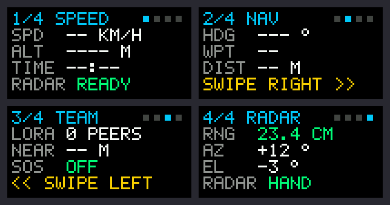

# PSOC&trade; Edge MCU: Graphics DSI ULPM on data lane

This code example demonstrates entry and exit in MIPI Display Serial Interface Ultra-Low-Power Mode (DSI ULPM) on the data lane only. In this mode, the DSI PHY state machine is entering a low-power state on the data lane and allows it to save some power when the LCD does not need to display. When the display is needed again, the DSI ULPM on the data lane is exited and the display should operate as before.
This code example uses a 4.3-inch Capacitive Touch IPS Display for Raspberry Pi, DSI Interface, 800x480 pixel from Waveshare connected via the MIPI DSI interface.

This code example has a three project structure: CM33 secure, CM33 non-secure, and CM55 projects. All three projects are programmed to the external QSPI flash and executed in Execute in Place (XIP) mode. Extended boot launches the CM33 secure project from a fixed location in the external flash, which then configures the protection settings and launches the CM33 non-secure application. Additionally, CM33 non-secure application enables CM55 CPU and launches the CM55 application.

[View this README on GitHub.](https://github.com/Infineon/mtb-example-psoc-edge-gfx-dsi-ulpm-data-lane)

[Provide feedback on this code example.](https://yourvoice.infineon.com/jfe/form/SV_1NTns53sK2yiljn?Q_EED=eyJVbmlxdWUgRG9jIElkIjoiQ0UyMzk1NDAiLCJTcGVjIE51bWJlciI6IjAwMi0zOTU0MCIsIkRvYyBUaXRsZSI6IlBTT0MmdHJhZGU7IEVkZ2UgTUNVOiBHcmFwaGljcyBEU0kgVUxQTSBvbiBkYXRhIGxhbmUiLCJyaWQiOiJhZHZhaXRqaXRlbmRyYS5uZXJsaWthckBpbmZpbmVvbi5jb20iLCJEb2MgdmVyc2lvbiI6IjIuMS4xIiwiRG9jIExhbmd1YWdlIjoiRW5nbGlzaCIsIkRvYyBEaXZpc2lvbiI6Ik1DRCIsIkRvYyBCVSI6IklDVyIsIkRvYyBGYW1pbHkiOiJQU09DIn0=)

See the [Design and implementation](docs/design_and_implementation.md) for the functional description of this code example.

## Requirements

- [ModusToolbox&trade;](https://www.infineon.com/modustoolbox) v3.7 or later (tested with v3.9)
- Board support package (BSP) minimum required version: 1.0.0
- Programming language: C
- Associated parts: All [PSOC&trade; Edge MCU](https://www.infineon.com/products/microcontroller/32-bit-psoc-arm-cortex/32-bit-psoc-edge-arm) parts

## Supported toolchains (make variable 'TOOLCHAIN')

- GNU Arm&reg; Embedded Compiler v14.2.1 (`GCC_ARM`) – Default value of `TOOLCHAIN`
- Arm&reg; Compiler v6.22 (`ARM`)
- IAR C/C++ Compiler v9.70.4 (`IAR`)
- Arm&reg; Toolchain for Embedded v22.1 (`LLVM_ARM`)

## Supported kits (make variable 'TARGET')

- [PSOC&trade; Edge E84 Evaluation Kit](https://www.infineon.com/KIT_PSE84_EVAL) (`KIT_PSE84_EVAL_EPC2`) – Default value of `TARGET`
- [PSOC&trade; Edge E84 Evaluation Kit](https://www.infineon.com/KIT_PSE84_EVAL) (`KIT_PSE84_EVAL_EPC4`)

## Hardware setup

This example uses the board's default configuration. See the kit user guide to ensure that the board is configured correctly.

Ensure the following jumper and pin configuration on board.
- BOOT SW must be in the HIGH/ON position
- J20 and J21 must be in the tristate/not connected (NC) position

### Supported display and electrical connection with KIT_PSE84_EVAL 

- **Waveshare 4.3 inch Raspberry Pi DSI 800*480 display:**  
  Connect the FPC 15-pin cable between the display connector and the PSOC&trade; Edge E84's RPi MIPI DSI connector as outlined in the table below and shown in Figure 1.

  Display's Connector | PSOC&trade; Edge E84 Evaluation Kit's connector
  ------------------- | ----------------------------------------------------
  DSI connector       | J39

  **Figure 1. Display connection with PSOC&trade; Edge E84 evaluation kit**

  

## Software setup

See the [ModusToolbox&trade; tools package installation guide](https://www.infineon.com/ModusToolboxInstallguide) for information about installing and configuring the tools package.

Install a terminal emulator if you do not have one. Instructions in this document use [Tera Term](https://teratermproject.github.io/index-en.html).

This example requires no additional software or tools.

## Operation

See [Using the code example](docs/using_the_code_example.md) for instructions on creating a project, opening it in various supported IDEs, and performing tasks, such as building, programming, and debugging the application within the respective IDEs.

1. Ensure that the 4.3-inch Raspberry Pi DSI LCD is connected to the board

2. Connect the board to your PC using the provided USB cable through the KitProg3 USB connector

3. Open a terminal program and select the KitProg3 COM port. Set the serial port parameters to 8N1 and 115200 baud

4. After programming, the application starts automatically and displays an Infineon logo on the LCD. Confirm that "PSOC Edge MCU: Graphics DSI ULPM On Data Lane" is displayed on the UART terminal followed by the instruction(s) to exercise DSI ULPM mode. As per the instruction(s) displayed on the terminal, press user button 1 (**USER BTN1**) on the kit

   **Figure 2. Infineon logo displayed on LCD**

   

   **Figure 3. Terminal output on program startup**

   

5. On **USER BTN1** press, the LCD turns OFF and the DSI PHY data lane enters in ULPM mode. Confirm the message for DSI ULPM entry on the terminal. The USER LED1 will also turn ON to indicate the same state

   **Figure 4. DSI ULPM entry**

   

6. After being in OFF mode for 6 seconds, the ULPM on data lane exits automatically and the LCD turns back ON, displaying the same image as before with a message indicating exit from ULPM was successful on the UART terminal. Also the USER LED1 will now turn OFF to indicate the DSI PHY data lane in run mode.

   **Figure 5. DSI ULPM exit**

   

## 60 GHz radar gesture control (HUD goggle prototype)

> **Status: not yet built with ModusToolbox and not yet tested on hardware.** The signal processing and gesture logic are verified only with synthetic radar frames on a PC (`tools/radar_host_test`).

The CM55 application drives the on-board Infineon XENSIV&trade; BGT60TR13C 60 GHz radar of the [PSOC&trade; Edge E84 AI Kit](https://www.infineon.com/KIT_PSE84_AI) and switches HUD pages with hand gestures, so that a skier can operate the goggle with a gloved hand (60 GHz passes through glove fabric; the hand is detected at 6 - 45 cm in front of the sensor):

Gesture | HUD action
------- | ----------
`SWIPE RIGHT` | next page (SPEED -> NAV -> TEAM -> RADAR -> SPEED)
`SWIPE LEFT`  | previous page
`SWIPE UP`    | home page (SPEED)
`SWIPE DOWN`  | RADAR page (live range / azimuth / elevation)
`PUSH`        | select; in this demo it starts the 6 s DSI ULPM (screen off), like USER BTN1. Disable with `DEFINES+=RADAR_PUSH_ENTERS_ULPM=0`

The panel is drawn on the right side of the LCD (x 512, y 196, 304 x 151 px). The SPEED / NAV / TEAM values are placeholders (`--`) until the sensor demos are merged.

**Hardware** (KIT_PSE84_AI schematic 630-60751-01 Rev03): SPI MISO P21.4, MOSI P21.5, CLK P21.6, CS P21.7; IRQ P20.3; RST P20.7. The code uses the BSP names `CYBSP_SPI_CONTROLLER_*`, `CYBSP_RSPI_*` and `CYBSP_RADAR_*`, as in the Infineon code example [mtb-example-psoc-edge-ml-deepcraft-deploy-radar](https://github.com/Infineon/mtb-example-psoc-edge-ml-deepcraft-deploy-radar). The radar needs `TARGET=KIT_PSE84_AI` (add the BSP with the Library Manager). With a BSP that has no radar (such as the default `KIT_PSE84_EVAL_EPC2`) the radar task is not started, the panel shows `RADAR N/A BTN2` and USER BTN2 switches pages instead. Whether the rest of this example (Waveshare display connection, USER BTN1/BTN2 names) works unchanged on KIT_PSE84_AI has not been checked.

**Processing** (one frame every 30 ms, 64 samples x 32 chirps x 3 RX, 58.5 - 62.5 GHz; the gesture preset of the Infineon example, *proj_cm55/radar/radar_settings.h*):

1. The FIFO interrupt (one frame = 6144 samples) wakes the *Radar Task*, which reads the frame with `xensiv_bgt60trxx_get_fifo_data()` ([sensor-xensiv-bgt60trxx](https://github.com/Infineon/sensor-xensiv-bgt60trxx) 2.x, PSOC Edge PDL SPI port). FIFO overflow or a missing interrupt for 500 ms restarts the sensor
2. `radar_dsp.c`: DC removal, Hann window and 64-point FFT per chirp and antenna (3.75 cm range bins); subtraction of a static clutter map (goggle frame, face, helmet); strongest range bin inside 6 - 45 cm with an adaptive noise floor; azimuth from the RX1/RX3 phase, elevation from RX2/RX3, radial velocity from the chirp-to-chirp phase
3. `radar_gesture.c`: a hand "track" starts after 2 detected frames and ends after 3 missed frames (or 1.5 s); it is classified from the change of azimuth / elevation (>= 25&deg;, swipe) or range (>= 7 cm closer, push), followed by a 360 ms cooldown
4. The GFX task pops gestures from a queue, changes the page, shows a 1.2 s toast and redraws the panel (every 200 ms for the live RADAR page). One UART line per gesture, for example
   `Radar: gesture SWIPE RIGHT (frames 12, d_az +73.6 deg, d_el +0.0 deg, d_range -0.0 cm)`

- All thresholds and the antenna mapping are in *proj_cm55/radar/radar_config.h* and can be overridden with `DEFINES+=...`. If swipes come out mirrored for the way the board is mounted, set `RADAR_AZ_SIGN=-1` (or `RADAR_EL_SIGN=-1`)
- The product code overrides the weak hook `radar_port_on_gesture()` (*radar_task.h*) to forward gestures to the UI. The rule-based recognizer can later be replaced with Infineon's gesture model (DEEPCRAFT&trade; Studio / xensiv-radar-gestures) using the same frame data
- Possible extensions with the same radar: goggle wear detection (static reflector at 1 - 3 cm with breathing micro-motion -> wake / sleep the HUD) and vital signs (breathing / heart rate); not implemented
- The GFX task now waits 20 ms per loop (`GFX_TASK_POLL_DELAY_MS`) so that it does not starve other tasks, and its stack was increased from 3x to 5x `configMINIMAL_STACK_SIZE`
- Sources: *proj_cm55/radar/* (`radar_task.c` = sensor bring-up and task, `radar_dsp.c` = signal processing, `radar_gesture.c` = gesture state machine, `radar_hud.c` = page model and panel renderer). Dependency: *proj_cm55/deps/sensor-xensiv-bgt60trxx.mtb*
- Host test with synthetic radar frames (swipes, push, hover, jitter, clutter only, sequence) and the panel preview, no ModusToolbox needed: `make -C tools/radar_host_test run`

## Related resources

Resources  | Links
-----------|----------------------------------
Application notes  | [AN235935](https://www.infineon.com/AN235935) – Getting started with PSOC&trade; Edge E8 MCU on ModusToolbox&trade; software   [AN239191](https://www.infineon.com/AN239191) – Getting started with graphics on PSOC&trade; Edge MCU
Code examples  | [Using ModusToolbox&trade;](https://github.com/Infineon/Code-Examples-for-ModusToolbox-Software) on GitHub
Device documentation | [PSOC&trade; Edge MCU datasheets](https://www.infineon.com/products/microcontroller/32-bit-psoc-arm-cortex/32-bit-psoc-edge-arm#documents)   [PSOC&trade; Edge MCU reference manuals](https://www.infineon.com/products/microcontroller/32-bit-psoc-arm-cortex/32-bit-psoc-edge-arm#documents)
Development kits | Select your kits from the [Evaluation board finder](https://www.infineon.com/cms/en/design-support/finder-selection-tools/product-finder/evaluation-board)
Libraries  | [mtb-dsl-pse8xxgp](https://github.com/Infineon/mtb-dsl-pse8xxgp) – Device support library for PSE8XXGP   [retarget-io](https://github.com/Infineon/retarget-io) – Utility library to retarget STDIO messages to a UART port
Tools  | [ModusToolbox&trade;](https://www.infineon.com/modustoolbox) – ModusToolbox&trade; software is a collection of easy-to-use libraries and tools enabling rapid development with Infineon MCUs for applications ranging from wireless and cloud-connected systems, edge AI/ML, embedded sense and control, to wired USB connectivity using PSOC&trade; Industrial/IoT MCUs, AIROC&trade; Wi-Fi and Bluetooth&reg; connectivity devices, XMC&trade; Industrial MCUs, and EZ-USB&trade;/EZ-PD&trade; wired connectivity controllers. ModusToolbox&trade; incorporates a comprehensive set of BSPs, HAL, libraries, configuration tools, and provides support for industry-standard IDEs to fast-track your embedded application development

 

## Other resources

Infineon provides a wealth of data at [www.infineon.com](https://www.infineon.com) to help you select the right device, and quickly and effectively integrate it into your design.

## Document history

Document title: *CE239540* – *PSOC&trade; Edge MCU: Graphics DSI ULPM on data lane*

 Version | Description of change
 ------- | ---------------------
 1.x.0   | New code example   Early access release
 2.0.0   | GitHub release
 2.0.1   | README updates 
 2.1.0   | Updated design files to fix ModusToolbox&trade; v3.7 build warnings
 2.1.1   | Added a define in the Makefile for graphics support in FreeRTOS-based projects
 

All referenced product or service names and trademarks are the property of their respective owners.

The Bluetooth&reg; word mark and logos are registered trademarks owned by Bluetooth SIG, Inc., and any use of such marks by Infineon is under license.

PSOC&trade;, formerly known as PSoC&trade;, is a trademark of Infineon Technologies. Any references to PSoC&trade; in this document or others shall be deemed to refer to PSOC&trade;.

---------------------------------------------------------

(c) 2023-2026, Infineon Technologies AG, or an affiliate of Infineon Technologies AG. All rights reserved.
This software, associated documentation and materials ("Software") is owned by Infineon Technologies AG or one of its affiliates ("Infineon") and is protected by and subject to worldwide patent protection, worldwide copyright laws, and international treaty provisions. Therefore, you may use this Software only as provided in the license agreement accompanying the software package from which you obtained this Software. If no license agreement applies, then any use, reproduction, modification, translation, or compilation of this Software is prohibited without the express written permission of Infineon.
 
Disclaimer: UNLESS OTHERWISE EXPRESSLY AGREED WITH INFINEON, THIS SOFTWARE IS PROVIDED AS-IS, WITH NO WARRANTY OF ANY KIND, EXPRESS OR IMPLIED, INCLUDING, BUT NOT LIMITED TO, ALL WARRANTIES OF NON-INFRINGEMENT OF THIRD-PARTY RIGHTS AND IMPLIED WARRANTIES SUCH AS WARRANTIES OF FITNESS FOR A SPECIFIC USE/PURPOSE OR MERCHANTABILITY. Infineon reserves the right to make changes to the Software without notice. You are responsible for properly designing, programming, and testing the functionality and safety of your intended application of the Software, as well as complying with any legal requirements related to its use. Infineon does not guarantee that the Software will be free from intrusion, data theft or loss, or other breaches (“Security Breaches”), and Infineon shall have no liability arising out of any Security Breaches. Unless otherwise explicitly approved by Infineon, the Software may not be used in any application where a failure of the Product or any consequences of the use thereof can reasonably be expected to result in personal injury.