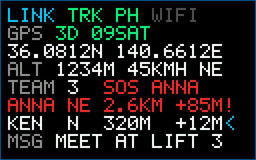

# Bluetooth LE and Wi-Fi connectivity (HUD goggle prototype)

> **Status: written against the ModusToolbox / btstack sources, not yet built with ModusToolbox and not yet run on a board.** The host unit test (`tools/goggle_link_host_test`) and a syntax check of the CM33 sources against the btstack 5.0.6 headers pass.

This branch adds the goggle side of the **HUD Link**: the goggle is a Bluetooth LE GATT server that the LoRa Tracker and the phone write to, and the CM55 draws what they send on a LINK panel. Wi-Fi is optional and normally off.




## 1. Architecture

```
 LoRa Tracker ──BLE GATT──┐                          ┌── CM55 (graphics)
   GNSS fix, team, msgs   │   CYW55513 (Murata 2FY)  │   LINK panel, x 528 y 196
                          ├─ HCI UART ─ CM33 NS ─────┤   prints the CM33 log
 Phone ──────BLE GATT─────┘   SDIO (Wi-Fi, optional) │
   nav cue, AI text, time,         btstack + WCM     │
   Wi-Fi credentials               goggle_bt_app.c   │
                                         │           │
                                         └─ m33_m55_shared (SoCMEM) mailbox ─┘
```

- **CM33 non-secure** owns the radio, exactly like the Infineon PSOC Edge Bluetooth examples (`mtb-example-psoc-edge-btstack-ess`, `-btstack-wifi-onboarding`): AIROC BT stack (`WICED_BLE`, LE only), Wi-Fi Connection Manager (`WCM`, lwIP, mbedTLS).
- **CM55** keeps the display and the debug UART. It polls the mailbox every GFX loop (20 ms), redraws the panel when the CM33 publishes new data (and once per second for the age counters) and prints the CM33 log lines with the prefix `[CM33]`.
- **Mailbox** (`shared/goggle_link/goggle_link_shm.*`): 8 KB at the end of the BSP region `m33_m55_shared` (SoCMEM 0x262FC000, 256 KB). Three blocks on separate 32-byte cache lines: `down` (CM33 → CM55), `up` (CM55 → CM33, goggle status) and a 2 KB log ring. `down` / `up` are seqlocks with D-cache clean / invalidate, so no IPC interrupt or semaphore is needed.

| Board signal (KIT_PSE84_AI) | E84 pin | Used by |
| --- | --- | --- |
| BT UART TX / RX / RTS / CTS | P10.0–P10.3 | btstack-integration HCI-UART (3 Mbps) |
| BT_REG_ON | P11.0 | btstack-integration |
| SDIO CLK / CMD | P12.0 / P21.0 | Wi-Fi |
| SDIO D0–D3 | P12.1 / P12.2 / P12.4 / P12.5 | Wi-Fi |
| WL_REG_ON | P11.4 | WCM (`cy_wcm_init` powers it, `cy_wcm_deinit` turns it off) |
| BT PCM / I²S | **not connected** | see §6 |

All pins come from the BSP (`CYBSP_BT_*`, `CYBSP_WIFI_*`); nothing is hard-coded.


## 2. GATT database

Hand-written in `proj_cm33_ns/connectivity/goggle_gatt_db.c` (no `design.cybt`, so the service is reviewed in one file and matches `goggle_link_proto.h`). Device name `ASUS HUD`, appearance *Eye glasses*, advertising: flags + 128-bit HUD Link service UUID + name (31 bytes), 30 ms for 30 s then 1.28 s. Up to **2 links at the same time** (Tracker + phone); advertising restarts while a slot is free. MTU 247.

| Handle | Characteristic | UUID (16-bit field in `4A5Dxxxx-6F1E-4B8C-9C3A-1D2E5A0B7C60`) | Properties | Writer |
| --- | --- | --- | --- | --- |
| 0x0012 | Battery Level (BAS) | 0x2A19 | R / N | goggle |
| 0x001A–1E | Manufacturer / Model / FW rev (DIS) | 0x2A29 / 0x2A24 / 0x2A26 | R | goggle |
| 0x0022 | **Tracker GNSS** | 0x0001 | W / WNR | Tracker, 1 Hz |
| 0x0024 | **Team** | 0x0002 | W / WNR | Tracker, on LoRa update |
| 0x0026 | **Message** | 0x0003 | W | Tracker / phone |
| 0x0028 | **Goggle status** | 0x0004 | R / N (1 Hz) | goggle |
| 0x002B | **Control** | 0x0005 | W | Tracker / phone |
| 0x002D | **Wi-Fi credentials** | 0x0006 | W, encrypted | phone |

Packet layouts (little endian, byte 0 = version 1) are documented field by field in `shared/goggle_link/goggle_link_proto.h`:

- **GNSS** (24 B): flags (fix / 3D), satellites, HDOP, lat / lon 1e-7°, altitude dm, speed cm/s, course 0.01°, UTC.
- **Team** (2 + 16 × n B, n ≤ 8): per member id, flags (SOS / stale / low battery / PTT talking), battery, LoRa RSSI, **bearing and distance from me**, altitude difference, age, 4-char name. The Tracker computes the relative values so the goggle needs no geodesy. A full team is 130 B, so the Tracker must request an MTU ≥ 133.
- **Message** (6 + ≤ 96 B): type (text / SOS / nav / AI), from, priority, time-to-live, UTF-8 text. The 5×7 font is upper-case ASCII; other characters show as `?` until a CJK font (LVGL) is added.
- **Control**: `HELLO` role (1 Tracker, 2 phone), `SET_TIME` UTC + time zone, `BRIGHTNESS`, `WIFI` on/off, `CLEAR_MSG`.
- **Goggle status** (16 B): battery, flags (charging / heater / Wi-Fi / SOS), link mask, speed, heading, altitude, temperature. On this branch the CM55 reports "unknown"; the sensor PRs fill it through the weak hook `gl_port_fill_status()`.

Every decoder checks version, length and ranges; a bad packet is rejected with an ATT error and logged.


## 3. Security and bonding

- `GOGGLE_LINK_SECURE=1` (default): every HUD Link write needs an encrypted link, so nobody in the lift queue can inject fake positions or a fake SOS. Wi-Fi credentials always need encryption.
- Pairing is **LE Secure Connections with MITM**: the goggle has a display but no keyboard (`DISPLAY_ONLY`), so the 6-digit passkey appears on the LINK panel (`PAIR CODE 123456`) and the user types it on the phone. The Tracker is meant to be bonded in the factory (goggle and Tracker ship as a set).
- Bonds (up to 4) and the local identity keys are stored in RRAM `user_nvm` with a CRC (`goggle_nvm.c`), so the phone reconnects after a reboot without "forget device". Wi-Fi credentials live in the same record; the password is never logged.
- Bring-up with a generic app (nRF Connect, LightBlue): `make GOGGLE_LINK_SECURE=0`.
- For the product: close pairing mode except during a button-held window, and decide whether to move the bond record to TF-M Protected Storage.


## 4. Wi-Fi

`goggle_wifi.c` is a station on the CYW55513 (the SDIO bring-up is copied from the Infineon onboarding example). The radio stays **off** (WL_REG_ON low) until:

1. the phone writes Wi-Fi credentials (stored, then joined), or
2. the phone / Tracker sends `CONTROL WIFI 1` (joins the stored network).

It switches off again on `CONTROL WIFI 0` or after `GOGGLE_WIFI_AUTO_OFF_S` (600 s). WPA2-PSK is used (also joins WPA2/WPA3 transition networks); a WPA3-only AP needs `CY_WCM_SECURITY_WPA3_SAE` or a scan first. Intended uses: OTA update (Edge Protect Bootloader swap slot), log / track upload and map download in the lodge or at home, not streaming on the slope.

Build without Wi-Fi: `make GOGGLE_WIFI=0` and delete `proj_cm33_ns/deps/wifi-core-freertos-lwip-mbedtls.mtb`.


## 5. Prototype chip (CYW55513) vs product chip (CYW55310)

| | **CYW55513** (Murata 2FY, on KIT_PSE84_AI / EVAL) | **CYW55310** (product, see the Bluetooth chip report) |
| --- | --- | --- |
| Radios | Wi-Fi 6/6E 1×1 + Bluetooth | **Bluetooth only** (BR/EDR + LE, LE Audio ISO / LC3) |
| Host interfaces | SDIO (WLAN) + UART (BT) | UART ≤ 4 Mbps, 2 × TDM / PCM |
| Package | module (antenna, crystal, RF on module) | WLBGA-143 3.57 × 5.32 mm, 0.35 mm pitch → HDI board, own RF matching / antenna |
| Supply | module rails from the kit | VBAT 3.0–4.8 V (RF spec 3.13–3.6 V), VDDIO 1.8 V only |
| Temperature | per Murata module datasheet (to check for −20 °C use) | −40 to +85 °C |
| BT firmware patch | downloaded by btstack-integration for the BSP's chip | needs the CYW55310 patch in the custom BSP (ask the FAE) |

What changes when moving this code to CYW55310:

1. Custom BSP: `CYBSP_BT_*` pins, BT_REG_ON / host-wake / device-wake, the CYW55310 firmware component, UART baud (up to 4 Mbps).
2. `make GOGGLE_WIFI=0` (no WLAN). OTA then goes over BLE (phone app) or USB.
3. Nothing in the GATT service, the mailbox or the HUD changes: the HCI interface and btstack API are the same.
4. If the goggle drives the SHOKZ headset itself: `COMPONENTS+=WICED_DUALMODE`, fill `p_br_cfg`, and add A2DP source / HFP AG (see §6).


## 6. Audio: BT PCM is not connected on KIT_PSE84_AI

On the AI kit the 2FY module's BT PCM / I²S pins are not routed to the E84, so **every audio path must go over the HCI UART**:

- **HFP (headset voice, mSBC 16 kHz / CVSD)**: use SCO over HCI. The official example `mtb-example-psoc-edge-btstack-hfp-ag` already does this (`ag_sco_path.path = WICED_BT_SCO_OVER_HCI`, PDM mic → `wiced_bt_sco_write_buffer`), so the AG role exists as an example.
- **A2DP source (SBC ≈ 328 kbps)** and **LE Audio (LC3 32–96 kbps)**: the encoded stream is ACL / ISO data over HCI anyway; the CM55 encodes (SBC / LC3 per AN242253).
- Cost: UART bandwidth is fine at 3 Mbps, but the host does all codec work and SCO over HCI adds latency / jitter; it also keeps the UART and the CM33 awake during calls.
- **Product board**: route CYW55310 TDM/PCM to an E84 I²S/TDM port so SCO can use the controller's PCM path and the host only moves PCM samples.

This branch does not implement audio; it only reserves the design.


## 7. Files

| Path | Core | Content |
| --- | --- | --- |
| `shared/goggle_link/goggle_link_proto.*` | both | packet codec, UUIDs, HUD helpers (pure C) |
| `shared/goggle_link/goggle_link_shm.*` | both | mailbox (seqlock), log ring |
| `proj_cm33_ns/connectivity/goggle_bt_app.*` | CM33 | stack init, GAP / pairing, GATT server, 1 Hz status notify |
| `proj_cm33_ns/connectivity/goggle_bt_cfg.*` | CM33 | `wiced_bt_cfg_settings_t`, advertising data |
| `proj_cm33_ns/connectivity/goggle_gatt_db.*` | CM33 | GATT database and handles |
| `proj_cm33_ns/connectivity/goggle_nvm.*` | CM33 | bonds + Wi-Fi credentials in RRAM |
| `proj_cm33_ns/connectivity/goggle_wifi.*` | CM33 | optional Wi-Fi station |
| `proj_cm55/link_hud/goggle_link_hud.*` | CM55 | LINK panel renderer |
| `tools/goggle_link_host_test/` | host | 130-check unit test, panel preview |
| `tools/ble_tracker_sim/goggle_ble_sim.py` | PC | Tracker / phone simulator (Python `bleak`) |


## 8. Bring-up checklist (on the board)

1. `make getlibs`, `make build` (GCC_ARM). Expect to fix small API differences: `btstack-integration` 7.x pulls its own btstack version, while this code was checked against btstack 5.0.6 headers.
2. Program; the UART shows `[CM33] NVM: ...`, `[CM33] BT ready, address ...`. If the BT stack never reports ready: check the 2FY firmware download (`CYBSP_BT_PLATFORM_CFG_BAUD_DOWNLOAD`) and that the template `design.modus` enables the BT UART.
3. With `GOGGLE_LINK_SECURE=0`, nRF Connect: find `ASUS HUD`, write `01 01 01` to Control (HELLO Tracker) → the panel shows `TRK` green.
4. `python3 tools/ble_tracker_sim/goggle_ble_sim.py` → GPS, team and message lines update every second.
5. Default build: pair from the phone, enter the code shown on the HUD, reboot the goggle, check that the phone reconnects without pairing again.
6. Wi-Fi: `goggle_ble_sim.py --phone --wifi SSID PASSWORD` → `[CM33] Wi-Fi: connected, IP ...`, then auto-off after 10 minutes.
7. Measure current: advertising at 1.28 s, connected at 30–50 ms interval with latency 4, Wi-Fi off.

Merge notes: `proj_cm55/main.c` conflicts with the sensor PRs (#1–#4) in the same places (GFX loop delay, stack 5×). The LINK panel uses x 528, y 196, 256 × 160 px (right middle), clear of the SHT40 panel on the left.
